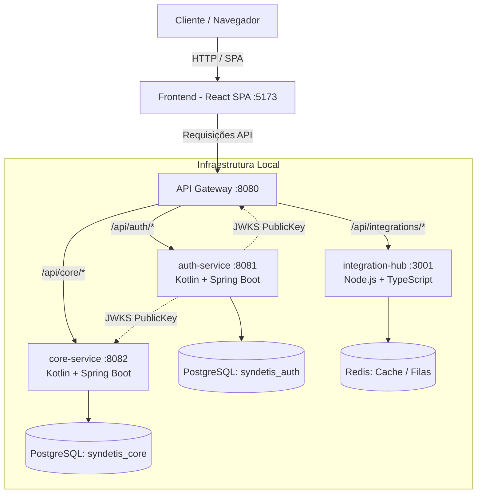

# Syndetis Web Platform

[](https://github.com/veltonMonte/Syndetis_Project_Web/actions)


> Plataforma SaaS multi-domínio para criação, gestão e personalização de **lojas virtuais (e-commerce)**.

O grande diferencial da plataforma é a **Sessão Maker**: uma interface de customização visual modular onde as escolhas de layout, paletas, animações e cards são serializadas em objetos JSON, persistidas em colunas `JSONB` no PostgreSQL e interpretadas dinamicamente pelo frontend, permitindo lojas personalizadas sem necessidade de novo deploy.

---

## 🏛️ Arquitetura de Microsserviços

O ecossistema é baseado em microsserviços desacoplados e poliglotas:



### Serviços

| Serviço | Stack | Porta | Descrição |
|---|---|---|---|
| **[frontend/](file:///frontend)** | React + TypeScript + Vite | `5173` | SPA para vitrine, checkout e Sessão Maker |
| **[gateway/](file:///gateway)** | API Gateway | `8080` | Ponto único de entrada, roteador e validação de tokens via JWKS |
| **[services/auth-service/](file:///services/auth-service)** | Kotlin + Spring Boot | `8081` | Autenticação local, OAuth2 (Google/GitHub) e emissão de JWT (RS256) |
| **[services/core-service/](file:///services/core-service)** | Kotlin + Spring Boot | `8082` | Regras de negócio, catálogo, pedidos, estoque e layouts JSONB |
| **[services/integration-hub/](file:///services/integration-hub)** | TypeScript + Node.js | `3001` | Hub assíncrono para Correios, WhatsApp, Gmail e webhooks |

---

## 📂 Estrutura do Monorepo

```text
Syndetis_Project_Web/
├── .github/                      # CI (GitHub Actions) e template de PR
├── docs/                         # Documentação: comece por docs/README.md
│   ├── architecture/             # Visão geral, limites do gateway e decisões (adr/)
│   ├── development/              # Ambiente local, loja demo, Kubernetes local
│   ├── integrations/             # Mercado Pago, Receita Federal, OAuth, Asaas
│   ├── deployment/               # AWS + Cloudflare, Neon
│   ├── operations/               # Homologação e validações
│   └── product/                  # Planos e Sessão Maker
├── frontend/                     # SPA React (Maker, vitrine, painel)
├── gateway/                      # API Gateway (Node): rotas, JWT, limites
├── services/
│   ├── auth-service/             # Kotlin: contas, JWT/JWKS, OAuth, CNPJ dos lojistas
│   ├── core-service/             # Kotlin: lojas, catálogo, pedidos, layout do Maker, pagamentos
│   └── integration-hub/          # TypeScript: Mercado Pago, Receita Federal, e-mail, frete, filas
├── packages/
│   └── store-contracts/          # Contratos TypeScript compartilhados da loja
├── libs/                         # Reservado para código Kotlin compartilhado
├── infra/
│   ├── docker/                   # Inicialização dos containers (Postgres)
│   ├── k8s/                      # Manifests Kustomize (base + overlay local)
│   └── neon/                     # Política de branches do Neon
├── scripts/
│   ├── aws/                      # Implantação em EC2
│   ├── ci/                       # Smoke de checkout usado no CI
│   ├── demo-store/               # Seed da loja demo "Casa Brisa"
│   ├── homologation/             # Validação do ambiente de homologação
│   └── kubernetes/               # Laboratório Kubernetes local
├── docker-compose.yml            # Ambiente local completo
├── compose.aws.yml               # Produção em EC2
├── compose.homologation.yml      # Homologação
├── CONTRIBUTING.md               # Branches, commits e PRs
└── AGENTS.md                     # Arquitetura e regras para agentes e pessoas
```

---

## 🚀 Como Executar Localmente

### Pré-requisitos
* [Docker](https://www.docker.com/) e Docker Compose
* [JDK 21](https://adoptium.net/) (para os serviços em Kotlin/Spring Boot)
* [Node.js 22.12+](https://nodejs.org/) (para o frontend, gateway e integration-hub)

### 1. Iniciar o ambiente completo

```bash
# Copie .env.example para .env e ajuste as variáveis locais.
docker compose up -d --build
```

Abra `http://localhost:8080`. O gateway entrega a SPA e encaminha as APIs; as portas dos serviços ficam restritas ao host. O pagamento fica desabilitado por padrão no ambiente local.

Para o domínio `https://syndetis-web.com`, credenciais de teste do Mercado Pago e configuração HTTPS, consulte **[o guia de homologação](docs/operations/homologacao.md)**. A versão integrada está registrada em [`VERSION`](VERSION).

O auth-service mantém sua chave RSA no volume `auth_keys`. O core-service usa
`http://auth-service:8081/.well-known/jwks.json` dentro da rede Compose.
Para habilitar login social, consulte
[docs/integrations/oauth-google-github.md](docs/integrations/oauth-google-github.md).

### 2. Desenvolvimento com recarregamento automático (opcional)

```bash
# Terminal 1 - Integration Hub
cd services/integration-hub
npm ci && npm run start:dev

# Terminal 2 - Frontend
cd frontend
npm ci && npm run dev
```

O gateway pode ser executado com `cd gateway && npm ci && npm run dev`. Para esse modo, use os serviços correspondentes no host e configure `PUBLIC_ORIGIN=http://localhost:5173` no gateway e `CORE_CORS_ALLOWED_ORIGINS=http://localhost:5173` no core. Evite executar a versão em container e a versão local do mesmo serviço na mesma porta.

---

## Kubernetes local

O laboratório em [docs/development/kubernetes-local.md](docs/development/kubernetes-local.md) usa o Kubernetes
do Docker Desktop em um namespace próprio, com probes, réplicas, volumes persistentes
e teste de recuperação de pod. Os dados e containers do Compose são preservados.

```powershell
node scripts/kubernetes/local.mjs build
node scripts/kubernetes/local.mjs deploy
node scripts/kubernetes/local.mjs serve
```

O acesso local é `http://127.0.0.1:8086`. O cluster de uma máquina não protege
contra desligamento do computador nem substitui bancos redundantes e backups.

## 🛠️ Padrões e Contribuição

Antes de abrir Pull Requests ou criar branches, leia as diretrizes:
* [Guia de Contribuição e Git Flow](CONTRIBUTING.md)
* [Convenções Técnicas e Arquitetura no AGENTS.md](AGENTS.md)

---

## 📄 Licença

Este projeto é desenvolvido para a disciplina de Integração de Sistemas. Todos os direitos reservados.
