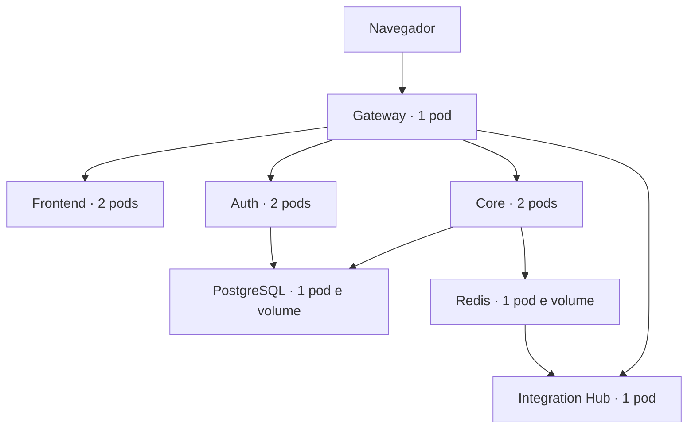

# Kubernetes local no Docker Desktop

Esta implantação é um laboratório de recuperação automática do Syndetis. Usa o
contexto `docker-desktop` e o namespace `syndetis-local`, sem modificar o Compose,
seus volumes ou os bancos de dados existentes. Os dados deste ambiente são novos.

## Docker, Compose e Kubernetes no Syndetis

O Dockerfile é a receita; a imagem é o pacote; o container é uma execução desse
pacote. Docker Compose descreve os containers e suas conexões no ambiente local.
Kubernetes usa essas imagens para manter a quantidade desejada de pods, retirar
instâncias indisponíveis do tráfego e substituir processos que falham. Neste
cluster kind, o runtime dos containers é containerd.



Um Deployment descreve, por exemplo, duas réplicas do core; o controlador cria
um novo pod quando uma delas desaparece. Um Service oferece um nome estável para
acessar os pods prontos. PostgreSQL e Redis usam StatefulSets e PVCs para separar
o ciclo de vida dos processos do armazenamento. Kubernetes não cria replicação
de banco simplesmente por aumentar o número de pods.

O Compose atual e o namespace Kubernetes são ambientes distintos. O primeiro
continua nas portas configuradas anteriormente; o segundo é acessado pelo
port-forward em 8086. Nenhum dado é migrado automaticamente entre eles.

## O que está configurado

| Componente | Réplicas | Comportamento |
| --- | --- | --- |
| Frontend | 2 | Reinício automático e atualização gradual. |
| Auth | 2 | Chave RSA compartilhada por Secret e sessões OAuth persistidas no PostgreSQL. |
| Core | 2 | Estado compartilhado no banco; limites e idempotência continuam no backend. |
| Gateway | 1 | Recuperação automática. Não escalar enquanto os limitadores de requisição usarem memória local. |
| Integration Hub | 1 | Identidade estável do consumidor, atualização `Recreate` e recuperação dos eventos pendentes desse consumidor. |
| PostgreSQL | 1 | StatefulSet e volume persistente de 2 GiB, com bancos separados para auth e core. |
| Redis | 1 | StatefulSet, volume persistente de 1 GiB e AOF; política `noeviction` para não descartar filas por pressão de memória. |

Frontend, auth e core usam `maxUnavailable: 0`, `maxSurge: 1`, período mínimo de
prontidão e PodDisruptionBudget com ao menos uma réplica disponível. Os PDBs
protegem contra interrupções voluntárias pelo mecanismo de eviction; não impedem
falhas de máquina, exclusão direta de pod ou interrupções forçadas.
[Deployments](https://kubernetes.io/docs/concepts/workloads/controllers/deployment/),
[PDB](https://kubernetes.io/docs/concepts/workloads/pods/disruptions/).

Todos os containers têm requests/limits de CPU e memória, execução sem root,
capabilities removidas e tokens de ServiceAccount desmontados. Os aplicativos
usam raiz somente leitura e diretório temporário gravável separado.
As variáveis automáticas de Service (`enableServiceLinks`) ficam desativadas;
conexões usam DNS e configuração explícita, evitando que `CORE_SERVICE_PORT`
receba uma URL `tcp://...` no lugar da porta numérica esperada pelo Spring.

## Verificações de saúde

- **Startup:** concede tempo para inicialização do Java, migrations e dependências.
- **Liveness:** verifica se o processo funciona. Uma falha persistente causa reinício.
- **Readiness:** retira instâncias indisponíveis do tráfego, sem reiniciá-las por
  uma falha externa. Auth/core incluem o banco; o Hub inclui Redis com timeout.
- Auth/core usam `/livez` e `/readyz` na mesma porta da aplicação. O Hub usa
  `/health/live` e `/health`; gateway usa `/health`; frontend usa `/`.
- Spring e Node recebem SIGTERM, com prazo de encerramento; há um pequeno período
  de drenagem antes do encerramento dos aplicativos.

Não usar o banco/Redis como dependência da liveness dos aplicativos, pois isso
provocaria reinícios de todas as réplicas durante uma indisponibilidade externa.
[Probes Kubernetes](https://kubernetes.io/docs/concepts/workloads/pods/probes/),
[Probes Spring Boot](https://docs.spring.io/spring-boot/reference/actuator/endpoints.html#actuator.endpoints.kubernetes-probes).

## Preparar o Docker Desktop

No Docker Desktop: **Kubernetes → Create cluster → kind → 1 nó → Create**.
O instalador precisa baixar os componentes. Não usar Reset cluster para uma
implantação normal: reset pode excluir os recursos e dados do cluster.
[Docker Desktop Kubernetes](https://docs.docker.com/desktop/use-desktop/kubernetes/).

Confirme:

```powershell
kubectl --context docker-desktop get nodes
```

O contexto precisa apontar para o Docker Desktop local e os nós devem estar Ready.
O script não troca seu contexto global; toda chamada especifica o contexto e o
namespace. Acesso ao Docker e às conexões locais precisa estar permitido.

## Construir e implantar

Na raiz do repositório, com Node.js, Docker e kubectl no PATH:

```powershell
node scripts/kubernetes-local.mjs validate
node scripts/kubernetes-local.mjs build
node scripts/kubernetes-local.mjs deploy
node scripts/kubernetes-local.mjs status
```

`build` constrói as cinco imagens com tags únicas. O perfil kind usa os próprios
containers dos nós para importar as imagens no containerd, evitando publicar
imagens em um registry externo. O caminho kubeadm aproveita o image store local.
Os manifests usam `imagePullPolicy: Never` para as imagens do projeto; execute
build/deploy em cada nova versão. As imagens oficiais de PostgreSQL/Redis podem
ser baixadas normalmente pelo cluster.

`deploy` verifica a API do cluster, importa as imagens, aplica namespace e Secrets,
valida os manifests no servidor, aplica os recursos e aguarda os rollouts. As
credenciais existentes são comparadas antes da aplicação para impedir uma troca
acidental de senha ou chave JWT.

### Credenciais e provedores externos

O script gera uma senha de banco, uma chave RSA e um lojista de homologação em
`k8s/.local/credentials.json`. O diretório é ignorado pelo Git. Não compartilhar
esse arquivo nem adicioná-lo ao controle de versão. Sua cópia local é necessária
para reutilizar os Secrets e executar os testes.

O script **não lê o `.env` da raiz**, não copia chaves de produção e não usa os
volumes `postgres_data`, `redis_data` ou `auth_keys` do Compose. Não remover os
Secrets ou o arquivo de credenciais para renovar uma implantação com PVCs existentes.
Rotação de senha/chaves exige um procedimento coordenado separado.

`BILLING_ENABLED=false` mantém o modo de prévia dos planos, com IA paga desativada.
`PAYMENTS_ENABLED=true` mantém as regras que impedem confirmar pagamento manualmente,
mas os tokens internos e as chaves de Mercado Pago/Asaas permanecem vazios. Portanto,
o laboratório não dispara cobranças externas. OAuth Google/GitHub também não recebe
credenciais: o teste usa login local do lojista de homologação.

Secrets Kubernetes não equivalem a um cofre externo. Este ambiente tem namespace
isolado e Pod Security, mas não configura criptografia de etcd, políticas de rede
ou uma fronteira de segurança de produção entre serviços.

## Abrir e testar

Em um terminal dedicado:

```powershell
node scripts/kubernetes-local.mjs serve
```

Abra **http://127.0.0.1:8086/**. O port-forward escuta somente no loopback.
O endereço do Compose e a prévia Vite continuam independentes.

Em outro terminal:

```powershell
node scripts/kubernetes-local.mjs smoke
node scripts/kubernetes-local.mjs test-recovery
```

O smoke cria dados demonstrativos e valida o checkout pela API real, incluindo
autenticação, permissões, catálogo, estoque, idempotência e cancelamento. Não
valida os fluxos simulados do novo frontend como se fossem integrações prontas.

O teste de recuperação exige duas réplicas saudáveis do core, exclui **um único pod
do core nesse namespace** e envia 100 consultas ao catálogo de produtos persistido
no PostgreSQL enquanto o Kubernetes o substitui. Cada resposta deve preservar o
produto criado pelo smoke. Não exclui PVC, banco, namespace ou arquivos. O teste só aprova se
houver substituto pronto e nenhuma falha HTTP observada; o relatório fica em
`k8s/.local/recovery-report.json`. Isso comprova o cenário medido, não uma garantia
de ausência de interrupções em qualquer tipo de falha.

`kubectl port-forward service/gateway` seleciona um pod específico. Se esse pod
for substituído, o port-forward precisa ser iniciado novamente. Não é um balanceador
externo com alta disponibilidade.

## Diagnóstico e rollback

```powershell
kubectl --context docker-desktop -n syndetis-local get pods,pvc,pdb
kubectl --context docker-desktop -n syndetis-local get events --sort-by=.lastTimestamp
kubectl --context docker-desktop -n syndetis-local logs deployment/core-service --tail=100
kubectl --context docker-desktop -n syndetis-local rollout undo deployment/core-service
```

Rollback de Deployment restaura a versão de imagem/configuração do pod quando
houver histórico, mas **não reverte migrations de banco**. Alterações de schema
devem ser compatíveis com a versão anterior durante um rollout. Não alterar
migrations já aplicadas.

Não usar `kubectl delete namespace`, excluir PVCs ou Reset cluster para reiniciar
a aplicação. Essas ações podem apagar os dados do laboratório.

## Limites e evolução para produção

O cluster local e todos os volumes continuam dependendo do mesmo computador e
Docker Desktop. Se ele desligar, o sistema fica indisponível. PostgreSQL, Redis,
gateway e worker não têm redundância nesta primeira entrega. Persistência não
substitui backups nem replicação; AOF `everysec` também não garante perda zero.

Antes de considerar produção com alta disponibilidade:

1. Cluster com nós em domínios de falha distintos, distribuição dos pods e
   balanceador/entrada HTTPS redundante.
2. PostgreSQL e Redis com estratégia de alta disponibilidade, backups e restauração
   testada. Não aumentar réplicas de PostgreSQL/Redis sem configurar replicação.
3. Rate limiting compartilhado antes de escalar gateway; recuperação de consumidores
   abandonados (`XAUTOCLAIM`) antes de escalar workers.
4. Revisar jobs agendados e conciliação de assinaturas para execução distribuída.
   O laboratório mantém cobrança externa desativada.
5. Garantir entrega durável dos eventos: o listener atual publica no Redis após
   commit; não há uma outbox transacional persistida que cubra falhas entre banco
   e Redis. Kubernetes não corrige essa janela da aplicação.
6. Métricas, alertas, centralização de logs, limites calibrados e ensaios de falha.
   HPA depende de métricas e de serviços preparados para escala; não está ligado
   automaticamente neste laboratório.

Planejamento mobile e integrações reais do frontend continuam entregas separadas.

## Validação realizada em 29/10/2026

- Docker Desktop com cluster kind 1.36.1 de um nó: ativo.
- Cinco imagens construídas, importadas no nó e aplicadas com validação no servidor.
- Segunda implantação com tags novas concluída, preservando Secrets e PVCs.
- Auth: 28 testes aprovados, incluindo as probes do perfil Kubernetes.
- Integration Hub: build aprovado e 68 testes aprovados, incluindo timeout de
  readiness e independência da liveness em relação ao Redis.
- Core: teste de integração do perfil Kubernetes aprovado, com probes públicas
  e APIs administrativas protegidas.
- Duas réplicas auth verificadas diretamente: mesmo JWKS público, sem campos
  privados na resposta.
- Smoke do checkout pelas APIs do cluster: aprovado, sem cobranças externas.
- Recuperação: um pod core removido; 100 consultas ao catálogo de produtos no
  PostgreSQL, zero falhas observadas e réplica substituta pronta.
- Containers do Compose e `evolution_api` preservados.

O relatório detalhado da recuperação fica no diretório local ignorado pelo Git.
